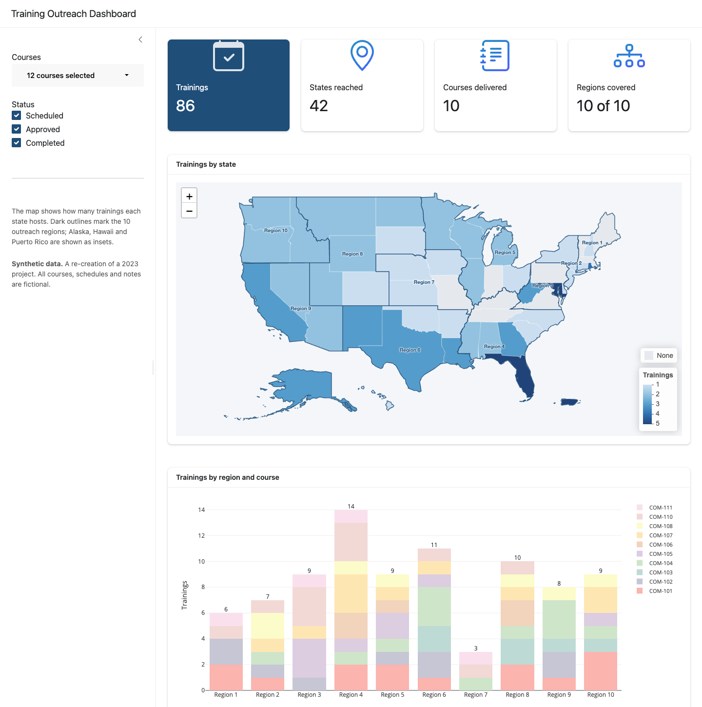

# Training Outreach Dashboard

An interactive R Shiny dashboard showing **where instructor-led trainings are delivered across the U.S.** and how each course is spread across 10 outreach regions. It's built for program staff who plan outreach and need to spot coverage gaps quickly.

**Live app:** [shuyanghuang325.shinyapps.io/training-outreach-dashboard](https://shuyanghuang325.shinyapps.io/training-outreach-dashboard/)

> **Synthetic data version of a 2023 project.** I originally built this dashboard in 2023 on an internal scheduling spreadsheet. This public version runs on **synthetic data**: courses are identified only by code (COM-101 to COM-112), and every schedule, status and note is fictional. The code has also been updated for current R packages.



| Item | Details |
|---|---|
| **Live app** | [Open the dashboard](https://shuyanghuang325.shinyapps.io/training-outreach-dashboard/) (hosted on shinyapps.io) |
| **Built with** | R · Shiny · bslib · Leaflet · sf · Plotly · tidyverse |
| **Data** | Synthetic training schedule (12 courses, 86 deliveries, 42 states) + U.S. Census state boundaries |
| **Original** | 2023, used by an operations team to track training scheduling and outreach |

## What It Does

- **Filter** by course (grouped by track, with search and select-all) and by status: Scheduled, Approved, Completed.
- **Summary cards** for total trainings, states reached, courses delivered, and regions covered.
- **Choropleth map** shading each state by number of trainings, with the 10 outreach regions outlined and labelled. Hovering over a state shows its region, total trainings, and a per-course breakdown. The map updates in place when filters change, so the zoom level and position are kept.
- **Stacked bar chart** of trainings by region and course, with region totals on top.

## From Messy Spreadsheet to Dashboard

The original data lived in a planning spreadsheet laid out for people, not for analysis:
- Two header rows.
- Category (track) rows mixed in with course rows.
- States typed under region columns, spilling onto extra rows when a course had many hosts.
- A totals row and footnotes at the bottom.

The synthetic file [`data/training_schedule_raw.csv`](data/training_schedule_raw.csv) keeps that same structure. [`R/clean_schedule.R`](R/clean_schedule.R) turns it into tidy data with one row per course and state:

```
raw sheet ──► detect region columns from the 2nd header row
          ──► drop rows after TOTAL, separate category rows from course rows
          ──► fill course/status down onto continuation rows
          ──► pivot region columns to long format ──► count deliveries
          ──► validate every state against its region (warn + drop mismatches)
```

## What Changed from the 2023 Version

| 2023 | Now |
|---|---|
| `rgdal` + `sp` (since removed from CRAN) | `sf` throughout |
| CARTO basemap tiles (now show an API-key notice) | **No tile layer at all**: states drawn on a plain background, so there's no external tile API or key and the map loads faster |
| Alaska/Hawaii far off-screen | Alaska, Hawaii and Puerto Rico moved into **insets** |
| Separate mini-map for one territory | Single map, consistent styling |
| `fluidPage` layout | `bslib` dashboard: sidebar, summary cards, full-screen-able cards |
| Selected courses outlined in red | Filters recompute the map, chart and summary cards together |
| Pastel stacked bars | Same Pastel1 palette, kept from the original |
| No data checks | State-to-region validation in the cleaning step |

## Repository Structure

```
├── app.R                               # Shiny app (UI + server)
├── R/clean_schedule.R                  # Spreadsheet → tidy data
├── scripts/
│   ├── generate_synthetic_data.R       # Creates data/training_schedule_raw.csv (seeded)
│   └── prepare_geography.R             # Builds state + region GeoJSON with insets
├── data/
│   ├── training_schedule_raw.csv       # Synthetic schedule (spreadsheet layout)
│   ├── state_regions.csv               # State → outreach region lookup
│   ├── us_states.geojson               # State shapes (insets applied)
│   └── regions.geojson                 # Regions dissolved from states, with label points
├── data-raw/us_states_simplified/      # Simplified U.S. Census state boundaries
└── images/dashboard.png
```

## Run Locally

```r
install.packages(c("shiny", "bslib", "bsicons", "shinyWidgets", "leaflet", "sf",
                   "plotly", "dplyr", "tidyr", "stringr", "readr", "RColorBrewer"))

shiny::runApp()
```

To regenerate the data (optional):

```bash
Rscript scripts/generate_synthetic_data.R
Rscript scripts/prepare_geography.R
```

## Data Sources

- **Training schedule:** synthetic, generated by `scripts/generate_synthetic_data.R` with a fixed seed.
- **State boundaries:** U.S. Census Bureau cartographic boundary file (2018, 1:20m), simplified. Public domain.
- **Outreach regions:** 10 groupings of states defined in `data/state_regions.csv`.
